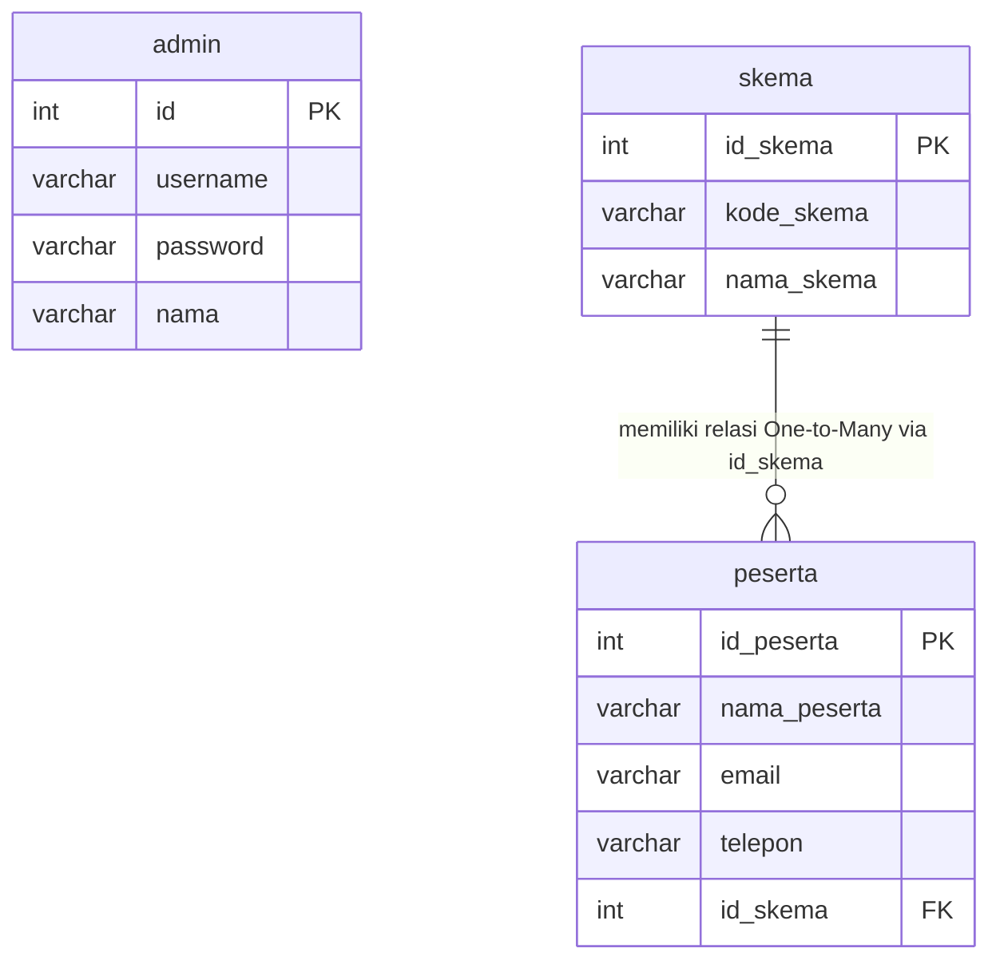

# 🎓 Aplikasi Pengelolaan Data Peserta Sertifikasi (Sertifikasi-USK)

[](https://www.php.net/)
[](https://www.mysql.com/)
[](#keamanan-sistem)
[](https://getbootstrap.com/)
[-blue?style=flat)](#skema-sertifikasi)

Aplikasi web dinamis berbasis **PHP Native, PDO, MySQL, dan Bootstrap 5** yang dirancang sebagai instrumen bukti pelaksanaan tugas praktik demonstrasi uji kompetensi keahlian (**Uji Sertifikasi Kompetensi / USK LSP-P1 / BNSP**) untuk okupasi **Junior Web Developer (FR.IA.02 - TPD)**.

---

## 📌 1. Identitas Asesi & Dokumen Sertifikasi
- **Nama Peserta / Asesi** : **Artvael Victor Sahetapy**
- **NISN**                 : **0094481212**
- **Asal Sekolah**          : **SMKN 64 Jakarta**
- **Skema Sertifikasi**     : **Okupasi - Junior Web Developer**
- **Nomor / Acuan Skema**   : Dokumen Skema LSP / FR.IA.02 – TPD
- **Repository GitHub**     : [https://github.com/Artvael/Sertifikasi-USK](https://github.com/Artvael/Sertifikasi-USK)
- **Laporan Resmi (PDF)**   : [`Dokumen/Laporan_ArtvaelVictorSahetapy_JWD.pdf`](Dokumen/Laporan_ArtvaelVictorSahetapy_JWD.pdf)

---

## 🎯 2. Keterangan & Tujuan Aplikasi

### A. Keterangan Singkat Aplikasi
Aplikasi Pengelolaan Data Peserta Sertifikasi adalah sistem manajemen berbasis web yang dibangun dengan arsitektur *server-side rendering* monolitik. Aplikasi ini dirancang khusus untuk memfasilitasi administrator dalam mengelola data master skema uji kompetensi dan data peserta sertifikasi secara terpusat, terstruktur, serta aman.

### B. Tujuan Aplikasi
1. **Digitalisasi Pendataan Peserta & Skema**: Memudahkan administrator mencatat, mengelompokkan, dan memonitor data peserta uji kompetensi beserta skema sertifikasi yang diambil secara terintegrasi.
2. **Efisiensi Pengelolaan & Pencarian Data**: Menyediakan operasi CRUD (*Create, Read, Update, Delete*) yang responsif serta fitur pencarian multi-kriteria berbasis nama, email, dan nomor telepon.
3. **Integritas & Keamanan Data Tingkat Tinggi**:
   - Menerapkan pembatasan hak akses berbasis sesi (*Authentication & Session Handling*).
   - Mengamankan seluruh komunikasi query database menggunakan **PDO Prepared Statements** berparameter binding guna mencegah kerentanan **SQL Injection**.
4. **Pemenuhan Standar Kompetensi BNSP / LSP**: Mengimplementasikan seluruh 6 Unit Kompetensi okupasi Junior Web Developer:
   - `J.620100.005.02` : Mengimplementasikan User Interface
   - `J.620100.010.01` : Menerapkan Perintah Eksekusi Bahasa Pemrograman Berbasis Teks, Grafik, dan Multimedia
   - `J.620100.015.01` : Menyusun Fungsi, File atau Sumber Daya Pemrograman dalam Organisasi yang Rapi
   - `J.620100.016.01` : Menulis Kode dengan Prinsip Sesuai Guidelines dan Best Practices
   - `J.620100.017.02` : Mengimplementasikan Pemrograman Terstruktur
   - `J.620100.019.02` : Menggunakan Library atau Komponen Pre-Existing (Bootstrap 5)

---

## 💻 3. Teknologi yang Digunakan

| Kategori | Komponen / Alat | Keterangan & Peran |
| :--- | :--- | :--- |
| **Backend Language** | PHP 8.x (Native) | Pemrosesan logika bisnis, session handling, autentikasi, dan operasi CRUD |
| **Database Engine** | MySQL / MariaDB | Penyimpanan relasional tabel `admin`, `skema`, dan `peserta` |
| **Database Driver** | PDO (PHP Data Objects) | Koneksi database aman dengan mode exception handling & Prepared Statements |
| **Frontend Styling** | HTML5, CSS3, Bootstrap 5.3.0 | Komponen antarmuka responsif: Grid system, Card, Navbar, Form, dan Table |
| **Web Server** | Apache (XAMPP) | Server web lokal untuk mengeksekusi PHP dan database MySQL |
| **Database Tool** | phpMyAdmin | Pembuatan skema relasi, foreign key, dan pengujian query |
| **Code Editor** | Visual Studio Code | Penyusunan source code, clean code structuring, dan debugging |
| **Version Control** | Git & GitHub | Manajemen versi kode program |

---

## ✨ 4. Fitur-Fitur Utama Sistem

1. **Autentikasi Administrator & Proteksi Sesi (`index.php`)**:
   - Form login aman dengan pengecekan akun di tabel `admin`.
   - Penyimpanan sesi `$_SESSION['admin']` saat login berhasil.
   - Proteksi ketat: Seluruh halaman admin otomatis menolak akses langsung via URL jika pengguna belum login.
2. **Dashboard Indikator Statistik (`dashboard.php`)**:
   - Menghitung total skema dan total peserta secara dinamis menggunakan query agregasi `SELECT COUNT(*) FROM ...`.
   - Navigasi cepat ke modul Skema dan modul Peserta.
3. **Modul Skema Sertifikasi (`skema.php`)**:
   - Form pintar ganda (*Dual-mode form*): Berfungsi untuk **Tambah Skema** baru dan beralih otomatis menjadi mode **Update Skema** saat tombol Edit diklik.
   - Tabel daftar skema sertifikasi lengkap dengan kode dan nama skema.
   - Fitur hapus data skema.
   - Tombol navigasi **Kembali ke Dashboard**.
4. **Modul Peserta Sertifikasi (`peserta.php`)**:
   - Form tambah peserta terintegrasi pilihan dropdown dinamis yang merujuk langsung ke tabel `skema` (Foreign Key `id_skema`).
   - Fitur **Pencarian Cepat** multi-kriteria berbasis operator SQL `LIKE` (`nama_peserta`, `email`, atau `telepon`).
   - Tombol **Reset Pencarian** otomatis muncul saat filter aktif.
   - Tombol aksi terpadu: **Detail**, **Edit**, dan **Hapus** (dengan dialog konfirmasi keamanan `onclick="return confirm(...)"`).
   - Tombol navigasi **Kembali ke Dashboard** dan **Logout**.
5. **Rincian Data Peserta Berelasi (`detail_peserta.php`)**:
   - Menampilkan detail informasi peserta yang digabungkan secara relasional dengan tabel skema menggunakan query SQL `JOIN`.
6. **Perubahan Data Peserta (`edit_peserta.php`)**:
   - Form modifikasi data peserta dengan nilai lama yang terisi otomatis (*pre-filled*) dan dropdown skema aktif yang terpilih (*selected*).
7. **Pemusnahan Sesi (`logout.php`)**:
   - Menghapus sesi login secara total melalui `session_destroy()` dan me-redirect pengguna ke halaman login awal.

---

## 🗄️ 5. Rancangan Basis Data (`db_sertifikasi.sql`)

Database bernama **`db_sertifikasi`** memiliki 3 tabel utama yang terhubung secara relasional:



File database siap pakai tersedia di root repositori: **[`db_sertifikasi.sql`](db_sertifikasi.sql)**.

---

## 🚀 6. Langkah-Langkah Menjalankan Project (Instalasi & Penggunaan)

Ikuti langkah-langkah mudah berikut untuk menjalankan proyek ini di komputer lokal:

### Langkah 1: Persiapan Server Lokal
1. Pastikan Anda telah menginstal **XAMPP** (disarankan PHP versi 8.0 ke atas).
2. Jalankan aplikasi **XAMPP Control Panel**.
3. Klik tombol **Start** pada modul **Apache** dan **MySQL**.

### Langkah 2: Mengunduh / Clone Repositori
Tempatkan folder proyek ini ke dalam direktori `htdocs` XAMPP:
```bash
cd C:\xampp\htdocs
git clone https://github.com/Artvael/Sertifikasi-USK.git Sertifikasi
```
*(Atau unduh ZIP dari GitHub lalu ekstrak dan beri nama folder `Sertifikasi` di dalam `C:\xampp\htdocs\`)*

### Langkah 3: Import Database MySQL
1. Buka browser dan akses **phpMyAdmin**:
   ```
   http://localhost/phpmyadmin
   ```
2. Buat database baru dengan nama:
   ```sql
   db_sertifikasi
   ```
3. Klik database `db_sertifikasi` yang baru dibuat, lalu pilih tab **Import** di bagian atas.
4. Klik tombol **Choose File / Telusuri**, lalu pilih file **`db_sertifikasi.sql`** yang berada di dalam folder proyek ini.
5. Gulir ke bawah dan klik tombol **Import / Kirim**.

*(Alternatif via Command Line / Terminal):*
```bash
mysql -u root -p db_sertifikasi < C:\xampp\htdocs\Sertifikasi\db_sertifikasi.sql
```

### Langkah 4: Membuka Aplikasi
1. Buka browser web (Google Chrome / Mozilla Firefox / Microsoft Edge).
2. Akses alamat URL berikut:
   ```
   http://localhost/Sertifikasi/index.php
   ```

### Langkah 5: Kredensial Login Administrator
Gunakan akun bawaan berikut untuk masuk ke sistem:
* **Username** : `admin`
* **Password** : `admin123`

---

## 📂 7. Struktur Direktori Proyek

```text
Sertifikasi/
├── 📄 index.php                   # Halaman form login admin & proses autentikasi
├── 📄 dashboard.php               # Halaman beranda utama dengan statistik agregasi COUNT(*)
├── 📄 skema.php                   # Modul CRUD master data skema sertifikasi
├── 📄 peserta.php                 # Modul CRUD data peserta, form tambah cepat, & filter pencarian
├── 📄 detail_peserta.php          # Halaman rincian data peserta (hasil query JOIN relasi skema)
├── 📄 edit_peserta.php            # Halaman form edit/update data peserta
├── 📄 koneksi.php                 # File konfigurasi koneksi database PDO & inisialisasi session global
├── 📄 logout.php                  # Skrip pemusnahan sesi (session_destroy) dan redirect login
├── 🗄️ db_sertifikasi.sql          # File dump database MySQL lengkap dengan relasi & data awal
├── 📘 README.md                   # Dokumentasi resmi dan petunjuk penggunaan aplikasi
│
├── 📁 Dokumen/                    # Berkas Laporan Resmi USK
│   ├── 📑 Laporan_ArtvaelVictorSahetapy_JWD.pdf  # Dokumen laporan resmi siap nilai (Format PDF)
│   └── 📑 LAPORAN UJI KOMPETENSI KEAHLIAN.docx   # Dokumen laporan lengkap (Format Word)
│
├── 📁 foto/                       # Kumpulan bukti screenshot aplikasi & pengujian
│   ├── 📁 Database foto/          # Bukti relasi foreign key, struktur tabel, dan record phpMyAdmin
│   ├── 📁 foto codingan/          # Bukti arsitektur kode backend PDO dan logika alur kerja
│   └── 📁 Tugas untuk ss Sertifikasi/ # Bukti tangkapan layar fitur login, CRUD, dan pencarian
│
└── 📁 ARTVAEL VICTOR SAHETAPY_JUNIOR WEB DEVELOPER/ # Folder Pengumpulan Standar FR.IA.02
    ├── 📁 01_SOURCE_CODE/        # Berisi ArtvaelVictorSahetapy_JWD.zip
    ├── 📁 02_SCREENSHOT/         # 12 Bukti tangkapan layar bernomor urut standar asesmen
    └── 📁 03_LAPORAN/            # Salinan berkas laporan resmi (PDF & DOCX)
```

---

## 🛡️ 8. Aspek Keamanan Sistem
- **Perlindungan Terhadap SQL Injection**: Menggunakan PDO Prepared Statements (`$koneksi->prepare(...)` dan `->execute([...])`) pada seluruh operasi database, memisahkan data input dari perintah SQL murni.
- **Session Authentication & Access Control**: Validasi status login (`if(!isset($_SESSION['admin']))`) pada setiap header modul sistem untuk mencegah akses URL langsung tanpa izin (*Unauthorized Direct Access*).
- **Redirection Termination**: Menambahkan `exit;` sesaat setelah `header("Location: ...")` untuk menghentikan eksekusi script PHP secara instan.
- **Konfirmasi Aksi Destruktif**: Setiap proses penghapusan data dilindungi dialog konfirmasi JavaScript untuk mencegah ketidaksengajaan penghapusan record.

---

## 📜 9. Lembar Bukti Laporan & Penilaian
Dokumen laporan tertulis lengkap 17 halaman mencakup identitas asesi, NISN, perancangan flowchart, skema database, bukti 24 screenshot, 10 tabel uji fungsionalitas (*Testing Checklist* seluruhnya berstatus **VALID**), kesimpulan, dan lembar pengesahan tersedia dalam format PDF:
* 📥 **[Unduh / Buka Laporan PDF](Dokumen/Laporan_ArtvaelVictorSahetapy_JWD.pdf)**

---
*Dibuat dengan dedikasi untuk Uji Sertifikasi Kompetensi (USK) Keahlian Rekayasa Perangkat Lunak / Pengembangan Web.*
